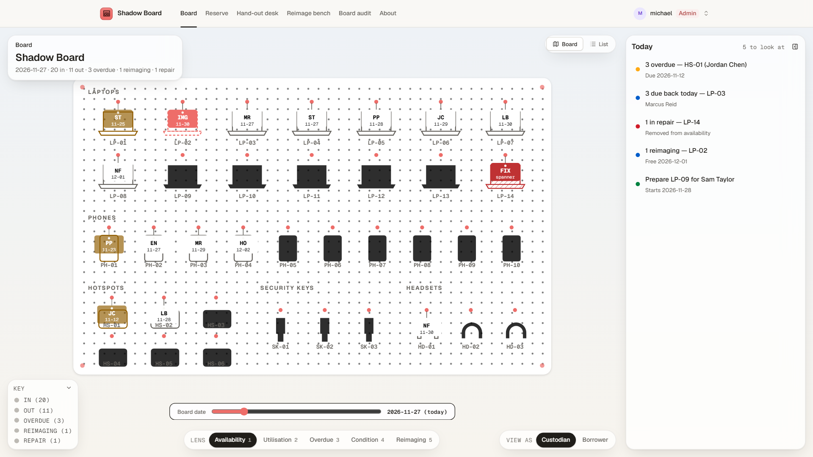

# Shadow Board (Hardware Loaner Pool)

A loaner pool with availability that accounts for reimaging time, best-fit allocation that keeps the pool utilised, kit checks on return, and a workshop pegboard anyone can read at a glance.




## This repository

```text
apps/shadow-board/   the app: React + Vite frontend, Rayfin data model (rayfin/), tests, demo walkthrough
shared/         shared package (@x10/shared): data store, sign-in runtime, UI kit, charts
tools/          deploy, seed, SQL and secrets-check scripts
```

Quick start (no Fabric tenant needed, runs in demo mode with sample data):

```bash
npm install
npm run dev
```

## Problem & Standard

Staff travelling over the holiday break borrow loaner laptops, phones and hotspots from a cupboard managed by a spreadsheet. Devices get double-booked, return without chargers, or appear "available" while still waiting to be reimaged. Shadow Board enforces turnaround buffers (2 business days for laptops, 1 for phones and accessories), 21-day loan limits, holiday-adjusted due dates, and return kit inspections.

## What It Looks Like

The centrepiece is a warm-grey workshop pegboard SVG where all 36 loaner assets have painted silhouettes grouped by kind. Solid silhouettes are in; empty outlines hang a linen tag with borrower initials and due date; overdue tags turn amber; reimaging units show a dashed outline; repair units are hatched with a spanner tag. Lenses switch between Availability, Utilisation, Overdue, Condition and Reimaging. Tools cover Reserve, Hand-out desk, Reimage bench, and Board audit. A full accessible List view mirrors the board one-to-one.

## Prerequisites

- Microsoft Fabric workspace on a capacity with the Fabric Apps workload enabled
- Edit permission on the workspace
- Node.js 20+

## Run Locally

```bash
npm install # at repo root
cd apps/shadow-board
npm run dev        # demo mode with deterministic seed and persona switcher (port 5307)
npm run dev:fabric # connected to Fabric
```

## Deploy

```bash
cd apps/shadow-board
npx rayfin up --workspace-id <workspace-id>
```

## Seed

```bash
npm run seed:fabric -- --admin-email you@org.com
```

Assign Custodian (`isAdmin`) in the `Person` table for staff who operate the Hand-out desk and Reimage bench.

## How It Works

| Entity | Purpose | Row Security |
| --- | --- | --- |
| `Asset` | Hardware item, kind, condition, expected kit | Custodian-owned (`claims.sub.eq(item.custodianSub)`) |
| `Loan` | Reservation and due dates | Borrower-owned (`claims.sub.eq(item.borrowerSub)`); domain blocks edits once handed out |
| `Handover` | Immutable out / in / repair log | Custodian create-only (`claims.sub.eq(item.custodianSub)`); no update/delete |

Pure rules in `src/domain/rules.ts` enforce turnaround buffers, best-fit interval allocation, 21-day max duration, return kit inspection, overdue escalation, and utilisation.

## Known Limits

- Role-based custodian checks (`isAdmin`) and blocking loan edits after hand-out are enforced in `src/domain/store.ts` in addition to Rayfin owner policies.
- Holiday dates default to winter break (`Dec 25`, `Dec 26`, `Jan 1`) per year.

## Later

- Barcode / QR scanning at the Hand-out desk.
- Automated email reminders along the overdue ladder.

## Gallery

- **Title:** 12 Days of Fabric Apps: Day 8.5 – Shadow Board
- **Blurb:** Holiday travel empties the IT loaner cupboard, and spreadsheets never show which laptops are still waiting to be reimaged. Shadow Board turns your hardware pool into a workshop pegboard: solid silhouettes are ready, empty outlines hang a borrower tag, and a date slider previews next week's gaps. Built with Fabric Apps for AI at Work, it enforces turnaround buffers, picks best-fit devices, and quarantines incomplete returns automatically.
- **Tags:** `Partner | 12 Days of Fabric Apps`

## License

MIT. See [LICENSE](LICENSE).
